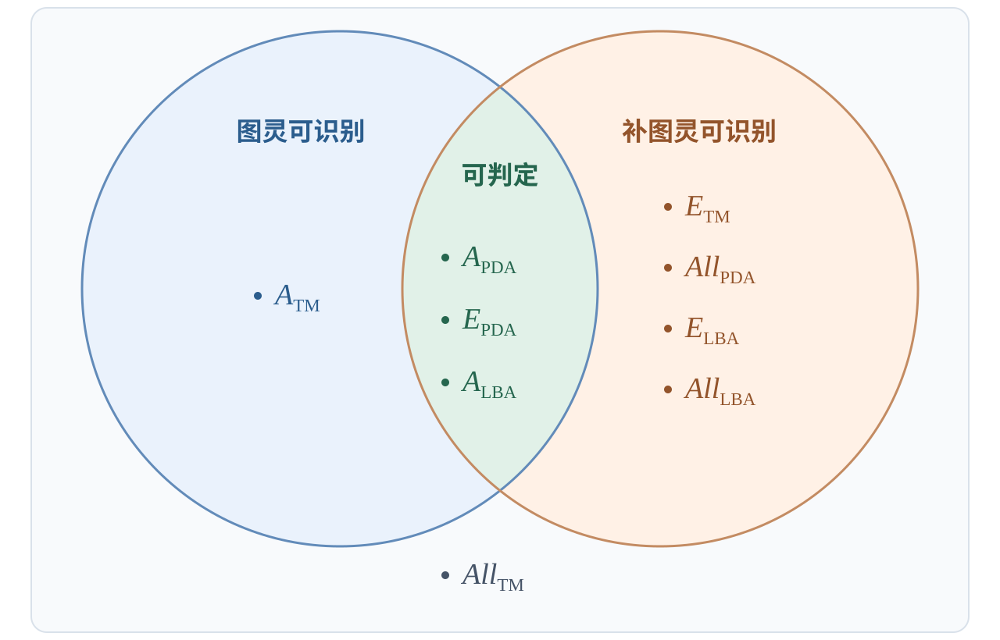
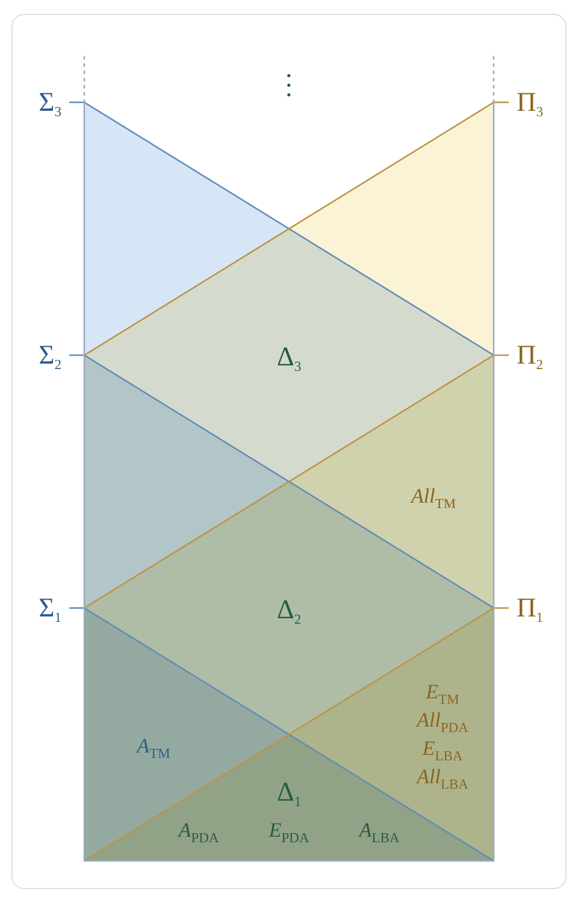

理论计算机科学基础（2026Fall）个人笔记。

## 前言

回忆上节课，我们使用对角化方法证明了图灵机的接受性问题 $A_{TM}$ 不可判定。除了对角化，还有另外两种方法来证明某个计算问题不可判定。本次介绍归约。

## 归约

给定字母表 $\Sigma$，语言 $A, B \subseteq \Sigma^*$，$f: \Sigma^* \to \Sigma^*$ 可计算。如果 $x \in A \Leftrightarrow f(x) \in B$（可以等价地写成 $A = f^{-1}(B)$），我们就称 $f$ 是一个**映射归约**（也叫多一归约，因为 $f$ 未必是单射，下文还会考虑别的归约），$A$ 可以**归约**到 $B$，记作 $A \le_m B$。

归约具有以下性质：
1. 封闭性：如果 $A \le_m B$ 且 $B$ 可判定，那么 $A$ 可判定。
2. 传递性：如果 $A \le_m B$，$B \le_m C$，那么 $A \le_m C$。
3. 补：$A \le_m B \Leftrightarrow \overline{A} \le_m \overline{B}$。

简证：
1. 假设图灵机 $M_B$ 判定 $B$，$M_f$ 计算 $f$，构造新图灵机 $M_A$：对于输入 $x$ 先运行 $M_f$ 计算 $f(x)$，再把计算结果交给 $M_B$ 进行判定，那么 $M_A$ 判定 $A$。
2. 设 $f$ 把 $A$ 归约到 $B$，$g$ 把 $B$ 归约到 $C$，把计算 $f$ 和 $g$ 的图灵机连起来得到计算 $h = g \circ f$ 的图灵机，它把 $A$ 归约到 $C$。
3. $x \in A \Leftrightarrow f(x) \in B$，因此 $x \notin A \Leftrightarrow f(x) \notin B$。

沿用证明思路，容易说明可识别性和补图灵可识别性对归约也是封闭的。

归约给出了另一种证明不可判定的思路：如果要证明 $B$ 不可判定，就把另一个已知不可判定的问题 $A$ 归约到它，这样 $A \le_m B$，如果 $A$ 不可判定，那么 $B$ 也不可判定。

## 各种计算问题的性质

已经证明图灵机的接受性问题 $A_{TM}$ 不可判定。下面证明：图灵机的空性问题 $E_{TM} = \{\langle M\rangle \mid L(M) = \varnothing\}$ 不可判定。

简证：我们来证明 $A_{TM} \le_m \overline{E_{TM}}$。我们希望构造一个归约 $f$ 使得 $f(\langle M, x\rangle) = \langle M'\rangle$，且 $M$ 接受 $x$ 等价于 $L(M') \neq \varnothing$。先构造 $M'$：如果 $M$ 接受 $x$，$M'$ 就接受任何串；如果 $M$ 拒绝 $x$，$M'$ 就拒绝任何串；$M$ 不停机，$M'$ 也不停机。这样 $M$ 接受 $x$ 等价于 $L(M') \neq \varnothing$，因为 $M$ 接受 $x$ 时 $L(M') = \Sigma^*$，反之 $L(M') = \varnothing$。$M'$ 可以如下构造：

TM $M'$ = “对于输入 $y$，

1. 模拟 $M$ 在 $x$ 上的计算；
2. 若 $M$ 接受 $x$，那么接受 $y$；若 $M$ 拒绝 $x$，那么拒绝 $y$；若 $M$ 不停机也不停机。”

进一步，虽然 $E_{TM}$ 不可判定，但它是补图灵可识别的，只需要使用楔形过程逐个试即可，如果非空总能有限步试出来。

接下来考虑图灵机的满性问题 $All_{TM} = \{\langle M\rangle \mid L(M) = \Sigma^*\}$。它同样不可判定，只需要证明 $A_{TM} \le_m All_{TM}$，还是利用上面那个归约。

进一步，$All_{TM}$ 不仅不可判定，它还不是图灵可识别的（也不是补图灵可识别的），这是因为还有 $\overline{A_{TM}} \le_m All_{TM}$。由于 $A_{TM}$ 和 $\overline{A_{TM}}$ 都能归约到 $All_{TM}$，如果 $A_{TM}$ 可识别，那么 $A_{TM}$ 和 $\overline{A_{TM}}$ 都可识别，进而 $A_{TM}$ 可判定，矛盾。

下面证明 $\overline{A_{TM}} \le_m All_{TM}$。我们需要构造 $f(\langle M,x\rangle) = \langle M'\rangle$ 且 $M$ 不接受 $x$ 当且仅当 $L(M') = \Sigma^*$。构造方式是，让 $M'$ 检查输入串 $y$ 是否是 $M$ 对 $x$ 的接受计算历史（设 $c_0, \dots, c_k$ 是 $M$ 在 $x$ 上的一次接受计算，接受计算历史指的是序列 $c_0, \dots, c_k$ 的编码），如果不是，那么接受。这样，当 $M$ 不接受 $x$ 时，$L(M') = \Sigma^*$，因为此时不存在接受计算；当 $M$ 接受 $x$ 时，$L(M')$ 不包含接受计算历史，因而是 $\Sigma^*$ 的真子集。这项检查当然可以由图灵机完成，对格局序列逐步模拟 $M$ 的运行即可。

事实上，“检查是否是接受计算历史”这件事不需要图灵机，只要下推自动机即可完成。另外，检查不是接受计算历史这件事请实际上只需要下推自动机就能做到。一个格局序列 $c_0, \dots, c_k$ 不是接受计算历史有以下可能：

1. $c_0$ 不是初始格局。
2. $\exists i$，$c_i$ 和 $c_{i+1}$ 不符合转移函数。
3. $c_k$ 不是接受格局。

我们把格局序列按照正-反-正-反-......的形式（$c_0, c_1^R, c_2, c_3^R, \dots$）放到输入带上，并且把所有格局预填充到相同长度。由于 PDA 具有不确定性，它可以执行多个分支：对于 1.，只需要验证格局是否形如 $q_0x$，只需要把 $q_0$ 和 $x$ 写入转移函数即可；3. 同理；对于 2.，PDA 可以不确定地对每个 $k$ 进行检查，由于我们事先按照一正一反的方式放置输入串，它只需要在读取 $c_k$（或 $c_{k}^R$）时压栈，在读取  $c_{k+1}^R$（或 $c_{k+1}$）时弹栈比对即可。这样我们就证明了，$All_{PDA}$ 也是不可判定的，基于 PDA 和 CFG 的等价性，$All_{CFG}$ 也是不可判定的。

除此之外，还能证明 $All_{CFG} = \{\langle G\rangle \mid L(G) = \Sigma^*\}$ 是补图灵可识别的。考虑 $\overline{All_{CFG}} = \{\langle G\rangle \mid L(G) \neq \Sigma^*\}$，枚举所有串逐个检查即可，这个不需要楔形过程，因为 $A_{CFG}$ 是可判定的（先按算法转化成乔姆斯基范式，长度为 $n$ 的串在 CNF 下需要 $2n-1$ 次派生，只需要穷举即可）。基于标记算法（给 $A \to \varepsilon$ 的 $A$ 加标记；如果一个产生式右侧都被加了标记，就给左侧也加标记；重复直到不变，最后检查初始符号是否有标记），$E_{CFG}$ 也是可判定的。

进一步地，比 PDA 更强的线性有界自动机 LBA 也能完成检查接受计算历史的任务（LBA 相当于一个只能在纸带上有输入的部分读写的图灵机），因而 $All_{LBA}$ 也是不可判定的。此外，$E_{LBA}$ 也是不可判定的，只需要把归约改成是接受计算历史才接受即可；$A_{LBA}$ 则是可判定的，因为 LBA 的格局只有有限多（$|q|^{|x|}|x||Q|$），只需要检查转移图有没有通向接受格局的路径，用标记算法即可。进而 $All_{LBA}$ 是补图灵可识别的，和 CFG 一个道理，逐个检查，只要不满迟早能检查出来。

最后，我们把这些计算问题全部标注在图中：

## Kleene 谱系

Kleene 谱系可以给上面讨论过的计算问题按层级分类（以下的 $R$ 均为可判定的谓词）：
1. $\Sigma_1$：$L = \{x \mid \exists y, R(x, y)\}$，等价于图灵可识别。
2. $\Pi_1$：$L = \{x \mid \forall y, R(x, y)\}$，等价于补图灵可识别。
3. $\Delta_1 = \Sigma_1 \cap \Pi_1$，等价于可判定。
4. $\Sigma_2$：$L = \{x \mid \exists y_1, \forall y_2, R(x, y_1, y_2)\}$。
5. $\Pi_2$：$L = \{x \mid \forall y_1, \exists y_2, R(x, y_1, y_2)\}$。
6. $\Delta_2 = \Sigma_2 \cap \Pi_2$。
7. ......

一般地，$\Sigma_n$ 是从 $\exists$ 开始交替 $n-1$ 次，$\Pi_n$ 是从 $\forall$ 开始交替 $n-1$ 次，而 $\Delta_n = \Sigma_n \cap \Pi_n$。这样形成的层级关系可以如图表示：

比如说，

$$E_{TM} = \{\langle M \rangle \mid \forall x, \forall y, y \text{ 是 } M \text{ 在 } x \text{ 上的接受计算历史}\}$$

由于两个 $\forall$ 可以合并成 $\forall (x, y)$，故 $E_{TM}$ 在 $\Pi_1$ 层级。然而，

$$All_{TM} = \{\langle M \rangle \mid \forall x, \exists y, y \text{ 是 } M \text{ 在 } x \text{ 上的接受计算历史}\}$$

这导致 $All_{TM}$ 处于 $\Pi_2$ 层级，比 $E_{TM}$ 高了一级。为什么 $All_{PDA}$，等价地 $All_{CFG}$ 和 $All_{TM}$ 不在同一层级？由于 $A_{CFG}$ 可判定，$All_{CFG}$ 可以直接写成

$$All_{CFG} = \{\langle G \rangle \mid \forall x, x \in L(G)\}$$

这样就只需要一个量词了。除了以上这些问题，还有等价性问题 $EQ = \{\langle M_1, M_2\rangle \mid L(M_1) = L(M_2)\}$，空性和满性都能归约到它，它的层级会更高。

如果对于某个语言 $L_0$，$\forall L \in \Sigma_n, L \le_m L_0$，就说 $L_0$ 是 $\Sigma_n$-完全的；$\Pi_n$ 和 $\Delta_n$ 同理。$A_{TM}$ 就是 $\Sigma_1$-完全的：$\forall L \in \Sigma_1$，$L = \{x\mid \exists y, R(x, y)\}$。设图灵机 $M$ 判定 $R$，我们可以构造一个图灵机，对于任意输入 $x$，枚举所有 $y$ 判定是否有 $R(x, y)$ 成立，只要 $x \in L$，就能有限步内找到 $y$，反之不停机；这样得到的映射 $f: x \mapsto \langle M, x\rangle$ 就把 $L$ 归约到 $A_{TM}$。这也是为什么上文说 $\Sigma_1$ 就等价于图灵可识别。上文已经证明过 $A_{TM} \le_m \overline{E_{TM}}$，由于归约的传递性，$E_{TM}$ 也是 $\Sigma_1$ 完全的。

Kleene 谱系可以一定程度上指示归约的方向，一般来说低层向高层归约，反之不行（严格来说，低层的完全语言一定能归约到高层的完全语言，一般情况未必；我们已经给出的这些语言都是完全的）；左右互相不能归约，但一个语言的补语言位于对侧；同层之间也可能存在归约关系（也是完全的情况下才一定能归约）。通过特定的方法可以构造出不完全的语言，也可以在层级中构造出任意形状的归约组合，这些问题就等待未来再探索吧。