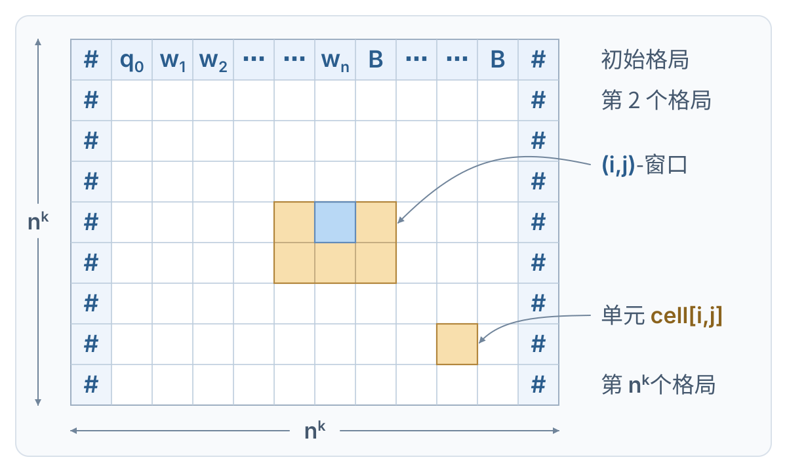
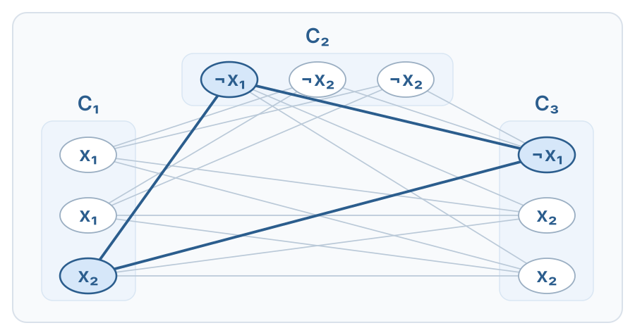
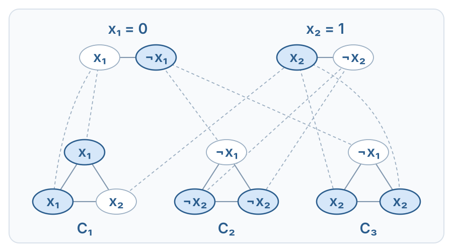
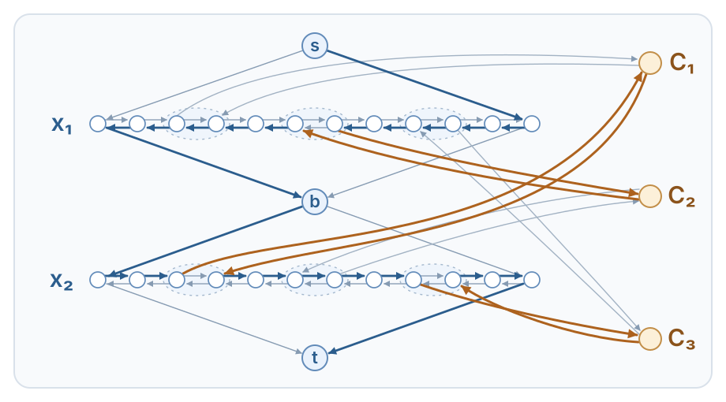
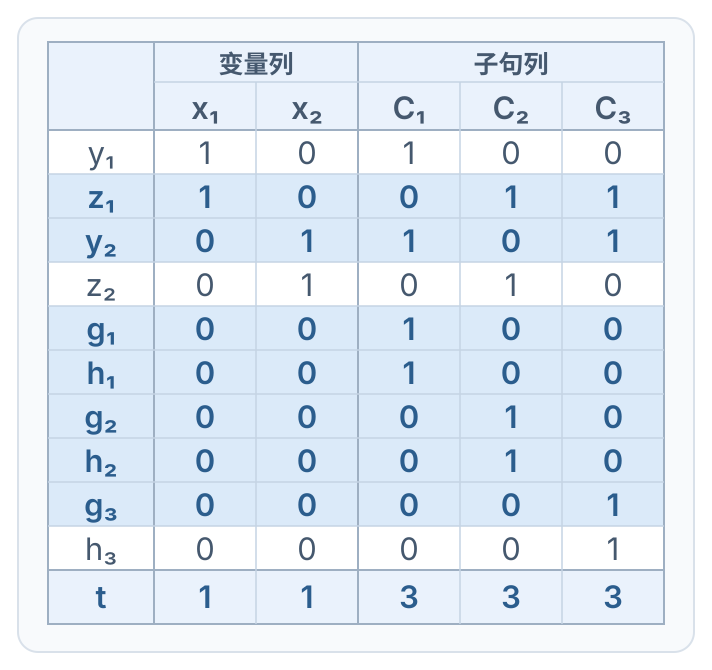

理论计算机科学基础（2026Fall）个人笔记。

## 前言

本节笔记先简要介绍复杂性理论基础，首先是 Blum 公理及相关推论（加速定理、间隙定理），其次是可构造性及层次定理，然后回到图灵机上定义时间复杂度并介绍线性加速定理，最后介绍 P, NP, EXP 等常见的复杂性类。在此基础上，还会进一步介绍 NP 完全理论，包括多项式时间归约、Cook-Karp-Levin 定理以及一些 NP 完全问题。

回忆渐进记号的定义：
- 若 $\exists C, n_0, \forall n > n_0, f(n) < Cg(n)$，就称 $f(n) = O(g(n))$；
- 若 $\lim_{n \to \infty} f(n)/g(n) = 0$，就称 $f(n) = o(g(n))$。

## 计算复杂性的一般定义

Blum 希望以一种抽象的方式定义计算复杂性，不依托于某个具体的计算模型。他是这样定义的：

- **定义域条件** 给定计算装置的枚举 $\varphi_1, \dots, \varphi_n, \dots$，它们计算的函数为 $f_1, \dots, f_n, \dots$，每个计算装置有一个度量（称为 Blum 度量）$F_1, \dots, F_n, \dots$。$\forall i$，$\forall x$，$\varphi_i$ 在 $x$ 上停机当且仅当 $f_i$ 在 $x$ 上有定义，也当且仅当 $F_i$ 在 $x$ 上有定义。
- **可判定性条件** 语言 $\{\langle i, x, m\rangle \mid F_i(x) = m\}$ 可判定。

这就是 **Blum 公理**。满足两个条件的度量就可以作为计算复杂性。对于图灵机来说，它运行的步数、使用的纸带长度都满足两个条件（模拟 $\varphi_i$ 在 $x$ 上运行，一边运行一边计数即可），就分别称之为图灵机的时间复杂性和空间复杂性。除此之外，读写头“调头”的次数也可以作为复杂性。

这个定义具备较强的一般性，但是会出现一些病态的现象，这里不给出证明：

**加速定理**（弱形式） $\exists f$，$\forall i$，若 $\varphi_i$ 计算 $f$（$f_i = f$），那么存在 $j$ 使得 $\varphi_j$ 也计算 $f$，并且对于几乎所有 $x$，$F_j(x) < F_i(x)$（“几乎所有 $x$”在这里指的是“除有限个 $x$ 之外”）。

**加速定理**（强形式） 对于任意可计算函数 $r$，$\exists f$，$\forall i$，若 $\varphi_i$ 计算 $f$（$f_i = f$），那么存在 $j$ 使得 $\varphi_j$ 也计算 $f$，并且对于几乎所有 $x$，$r(F_j(x)) < F_i(x)$。

直观上，加速定理是说总有函数 $f$ 没有最优算法，如果 $\varphi_i$ 计算它，那么一定存在（除有限个输入以外）算得更快的 $\varphi_j$。强形式则是说，可以以任意的强度去加速，比如平方加速 $F_j(x)^2 < F_i(x)$ 或是指数加速 $2^{F_j(x)} < F_i(x)$，$2^{2^{F_j(x)}} < F_i(x)$ 等等。

**间隙定理** 对于任意满足 $\forall x, g(x) \ge x$ 的全可计算函数 $g$，存在全可计算函数 $f$，使得 $\forall i$，对于几乎所有 $x$，$F_i(x)$ 有定义 $\Rightarrow$ $F_i(x) \notin [f(x), g(f(x))]$。

直观上，间隙定理是说可计算性的度量之间可以存在任意大的“无人区”，没有函数的复杂性能落在这个区间之中。

为了排除间隙定理这样的情况，后来的人们引入了**可构造性条件**：

- 给定可计算函数 $t$，若存在图灵机 $M$，对于任意输入 $x$ 恰好运行 $t(|x|)$ 步后停机，就称 $t$ **时间可构造**；也可以定义为，存在图灵机 $M$，在输入 $1^n$ 上，于 $O(t(n))$ 步内输出 $t(n)$。
- 给定可计算函数 $s$，若存在图灵机 $M$，对于任意输入 $x$ 恰好使用 $s(|x|)$ 个纸带格子后停机，就称 $s$ **空间可构造**；也可以定义为，存在图灵机 $M$，在输入 $1^n$ 上，使用不超过 $O(s(n))$ 个格子后输出 $s(n)$。 

可构造性条件可以导出另一个重要结论（这里只是简单一提，之后的笔记会更详细地讨论）：

**层次定理**（时间） 如果 $t$ 时间可构造，$\tau = o(t/\log t)$，那么存在语言 $L$，$L$ 能在 $O(t)$ 时间内被判定，但不能在 $O(\tau)$ 时间内被判定。

**层次定理**（空间） 如果 $s$ 空间可构造，$\sigma = o(s)$，那么存在语言 $L$，$L$ 能在 $O(s)$ 空间内被判定，但不能在 $O(\sigma)$ 空间内被判定。

直观上，层次定理是说，在符合相应的可构造性条件后，$t$ 和 $o(t/\log t)$ 之间一定有语言，$s$ 和 $o(s)$ 之间一定有语言；换言之时间和空间是有效的度量，计算资源的增加会带来语言类的扩大。注意到时间带有 $\log$ 因子而空间没有，这是由于空间能重复利用而时间不能。

## 图灵机的时间复杂性

### 基本定义

下面把视角放回到图灵机上。给定图灵机 $M$，定义

$$
t_M(x) = \begin{cases}
m, & c_0, c_1, \dots, c_m \text{ 是一段接受/拒绝计算历史} \\
\infty, & M \text{ 在 } x \text{ 上不停机}
\end{cases}
$$

$$
t_M(n) = \begin{cases}
\text{（最坏情况）} \max_{|x|=n}t_M(x) \\
\text{（平均情况）} \sum_{x \in \Sigma^n} t_M(x) / 2^n
\end{cases}
$$

后文使用最坏情况的复杂度。

定义导出的直接结论是：

**线性加速定理** 对任意图灵机 $M$ 和它接受的语言 $L$，如果 $t_M(n) \ge n^2$，则 $\forall c > 0$，存在图灵机 $M'$，使得 $M'$ 也接受 $L$ 并且 $\forall n, t_{M'}(n) \le c t_M(n) + O(n)$。

**证明思路** 合并纸带的格子，比如说 $c = 1/100$ 的时候，需要加速一百倍，就把每 $100$ 个相邻的格子合成一个，新图灵机在这个新的纸带上模拟原图灵机的行为。只有原图灵机走出一个区域的时候，新图灵机才会移动一步。$O(n)$ 来自于读输入的时间开销。由于单带图灵机读输入的时间压缩起来比较困难，所以额外有 $t_M(n) \ge n^2$ 的要求，多带图灵机不需要这个条件，并且可以明确地写成 $t_{M'}(n) \le c t_M(n) + n + 2$。

注意，我们讨论复杂度类的时候一律以确定性单带图灵机为标准。单带图灵机模拟多带图灵机有平方的开销，如果多带图灵机的复杂度是 $t(n)$，那么单带图灵机的复杂度是 $O(t(n)^2)$。（如果使用两带图灵机，那么复杂度是 $O(t(n)\log t(n))$，不过单带模拟两带仍需要 $O(t(n)^2)$。）确定性图灵机模拟非确定性图灵机有指数的开销，如果非确定性图灵机复杂度为 $t(n)$，那么确定性图灵机复杂度为 $2^{O(t(n))}$。定义

$$
\mathsf{TIME}(t(n)) = \{\text{存在图灵机 } M, M \text{ 判定 } L, t_M(n) = O(t(n))\}
$$

$$
\mathsf{NTIME}(t(n)) = \{\text{存在非确定性图灵机 } M, M \text{ 判定 } L, t_M(n) = O(t(n))\}
$$

为了强调确定性，$\mathsf{TIME}$ 也写作 $\mathsf{DTIME}$。

注意输入长度 $n$ 是和编码方式相关的，比如输入图 $G = \langle V, E\rangle$ 的时候，不同的编码方式带来的输入长度有区别；输入的参数是整数 $k$ 时，需要进行二进制编码，输入长度 $n = O(\log k)$。不同的算法的复杂度当然也有区别，以语言 $A = \{0^k1^k \mid k \in \mathbb{N}\}$ 为例，可以让图灵机从两端开始向内匹配 $0$ 和 $1$，这样的复杂度是 $O(n^2)$。还可以让图灵机先检查是否是 $0^a1^b$，然后每轮划去第 $1, 3, 5, \dots$ 个未划去的符号，并且在有限控制中比较本轮原有的 $0$ 和 $1$ 数量的奇偶性，如果奇偶性不同就拒绝，这样每轮长度减半，就只需要 $O(n\log n)$ 的时间。可以证明，图灵机在 $o(n\log n)$ 时间内只能识别正则语言。

### P，NP 和 EXP

下面的复杂性类非常重要~~也非常出名~~：

$$
\mathsf{P} = \bigcup_{k \in \mathbb{N}} \mathsf{TIME}(n^k)
$$

$$
\mathsf{NP} = \bigcup_{k \in \mathbb{N}} \mathsf{NTIME}(n^k)
$$

$\mathsf{P}$ 是多项式时间可判定的语言类，$\mathsf{NP}$ 则是多项式时间可验证的语言类。直观上看，非确定性图灵机把“猜”一个解然后去验证。严格来说，给定图灵机 $V$ 和语言 $A = \{w \mid \exists c \in \Sigma^*, V \text{ 接受 } \langle w, c \rangle\}$，$V$ 称作验证器，$c$ 称作证书。如果 $|c|$ 是 $|w|$ 的多项式，并且 $V$ 在多项式时间内运行，就称 $A$ 是多项式时间可验证的。
- 如果 $A$ 多项式时间可验证，设验证时间为 $n^k$，可以构造非确定性图灵机 $N$：对于输入 $w$，$|w| = n$，非确定地选择长为 $n^k$ 的字符串 $c$，在 $\langle w, c\rangle$ 上模拟 $V$，若 $V$ 接受才接受，否则拒绝。因而 $A \in \mathsf{NP}$。
- 如果 $A \in \mathsf{NP}$，设非确定性图灵机 $N$ 判定 $A$，构造多项式时间验证器 $V$：对于输入 $\langle w, c\rangle$，在 $w$ 上模拟 $N$，把 $c$ 视作对 $N$ 的每一步选择的描述；如果 $N$ 的该计算分支接受就接受，否则拒绝。因而 $A$ 多项式时间可验证。

$\mathsf{coNP}$ 为 $\mathsf{NP}$ 的补语言。$\mathsf{coNP}$ 和 $\mathsf{NP}$ 是否相等目前还未知。$\mathsf{P} \subseteq \mathsf{NP} \cap \mathsf{coNP}$，是 $=$ 还是 $\subsetneq$ 目前也未知。这个关系很像图灵可识别/补图灵可识别/图灵可判定之间的关系，只是包含关系的严格性完全未知。除此之外，还有指数复杂性类

$$
\mathsf{EXP} = \bigcup_{k \in \mathbb{N}} \mathsf{TIME}\left(2^{n^k}\right)
$$

显然 $\mathsf{P} \subseteq \mathsf{NP} \subseteq \mathsf{EXP}$。虽然 $\mathsf{P} =? \mathsf{NP}$ 是著名的未解决问题，但我们之后可以使用对角化方法来证明 $\mathsf{P} \neq \mathsf{EXP}$。

下面是 PPT 里的例子。

- **有向路径问题（PATH）** 给定有向图 $G$ 和顶点 $s,t$，问 $t$ 是否从 $s$ 可达，也即 $\mathsf{PATH} = \{\langle G,s,t\rangle \mid \text{有向图 }G\text{ 有从 }s\text{ 到 }t\text{ 的有向路径}\}$。从 $s$ 出发做 BFS，依次标记能到达的顶点。借助邻接表，只需要 $O(|E|)$ 的时间，所以 $\mathsf{PATH} \in \mathsf{P}$。
- **互素问题（RELPRIME）** 给定两个以二进制表示的正整数 $a,b$，判断 $\gcd(a,b)$ 是否为 $1$，也即 $\mathsf{RELPRIME} = \{\langle a,b\rangle \mid \gcd(a,b)=1\}$。用辗转相除法可以做到 $O(n^2)$（总共 $O(n)$ 次除法，每次除法的开销是 $O(n)$ 的），$\mathsf{RELPRIME} \in \mathsf{P}$。
- **上下文无关语言的成员判定** 借助乔姆斯基范式暴力枚举的复杂度是 $2^{O(n)}$ 的，但是可以使用动态规划做到 $O(n^3)$。也是先转化到乔姆斯基范式，然后维护一个 $n \times n$ 表格，$(i,j)$ 项表示能产生子串 $w_i\dots w_j$ 的变元。先用 $A \to a$ 填长度为 $1$ 的子串；对于长度为 $k+1$ 的子串，有 $k$ 种方式切分成两段，对每条规则 $A \to BC$，检查 $B$ 是否生成第一段，$C$ 是否生成第二段。整串对应的格子包含初始变元时接受。用时 $O(n^3)$，因此每个上下文无关语言都在 $\mathsf{P}$ 中。
- **（有向）哈密顿路径问题（HAMPATH）** 在 $\mathsf{PATH}$ 的基础上额外要求“每个顶点都恰好经过一次”，也即 $\mathsf{HAMPATH} = \{\langle G,s,t\rangle \mid \text{有向图 }G\text{ 有从 }s\text{ 到 }t\text{ 的哈密顿路径}\}$。目前未知是否 $\in \mathsf{P}$。不过显然 $\mathsf{HAMPATH} \in \mathsf{NP}$，以顶点序列作为证书，只需检查首尾是 $s,t$、每个顶点恰好出现一次，以及每对相邻顶点之间有方向正确的边。另外，假如有 HAMPATH 判定程序，还能用它来找出哈密顿路径。先确认原图的答案是“有”，再逐条尝试删边。删边后仍有哈密顿路径就保留这次删除，答案变成“无”就恢复该边。最后留下的边恰好构成一条哈密顿路径。
- **合数问题（COMPOSITES）** 问给定的数是否是合数，也即 $\mathsf{COMPOSITES} = \{x \mid x=pq,\ p,q\in\mathbb{N},\ p,q>1\}$。给定整数 $x>1$，可以用一个满足 $1<d<x$ 的因子 $d$ 作证书。检查范围和 $x\bmod d=0$ 都只需多项式时间，所以 $\mathsf{COMPOSITES} \in \mathsf{NP}$。
- **素数问题（PRIMES）** 问给定的数是否是素数，也即 $\mathsf{PRIMES} = \{p \in \mathbb{N} \mid p\text{ 是素数}\}$。对 $p > 1$，乘法群 $\mathbb{Z}_p^*$ 是 $p-1$ 阶循环群当且仅当 $p$ 是素数，因此只需要寻找阶为 $p-1$ 的元素 $g$。给定整数 $p > 2$，有因子分解 $p - 1 = q_1^{e_1}\dots q_r^{e_r}$，其证书递归地由 $C(p) = ((q_i, e_i)_i, g, C(q_1), \dots, C(q_r))$ 给出；$p = 2$ 时证书为空。验证的过程如下：
  
  1. 检查 $p \ge 2$，$p = 2$ 直接接受；
  2. 检查 $p - 1 = q_1^{e_1} \dots q_r^{e_r}$；
  3. 对每个 $i$，利用 $C(q_i)$ 递归检查 $q_i$ 是否是素数；
  4. 检查 $1 < g < p$；
  5. 检查 $g^{p-1} \equiv 1 \pmod{p}$；
  6. 对每个 $i$，检查 $g^{(p-1)/q_i} \not\equiv 1 \pmod{p}$。

  计算 $g^{p-1} \mod p$ 可以使用快速幂算法，只需要 $O(\log (p-1))$ 次乘法，而输入规模 $n = O(\log p)$，乘法的开销是多项式的，因此整体计算时间也是多项式的。同时，递归深度不超过 $O(\log p)$，证书长度可以归纳证明不超过 $O((\log p)^2)$，所以能做到多项式时间验证。

  > 实际上可以证明，COMPOSITES 和 PRIMES 都是 P 的，依靠的是 2002 年由 Agrawal、Kayal 和 Saxena 提出的 AKS 算法，这里不展开。
  
- **团问题（CLIQUE）** 给定无向图 $G$ 和整数 $k$，问是否有 $k$ 个顶点两两相邻，也即 $\mathsf{CLIQUE} = \{\langle G,k\rangle \mid \text{无向图 }G\text{ 有 }k\text{ 团}\}$。证书是这 $k$ 个顶点，验证时检查它们互不相同且每对之间都有边，所以 $\mathsf{CLIQUE} \in \mathsf{NP}$。
- **子集和问题（SUBSET-SUM）** 给定整数多重集 $S$ 和目标 $t$，问能否选出若干元素使其和为 $t$，也即 $\textsf{SUBSET-SUM} = \{\langle S,t\rangle \mid \exists T\subseteq S,\ \sum_{x\in T} x=t\}$，其中 $S,T$ 都是多重集。证书可以用下标指出选了哪些元素，验证时检查这些元素的和是否是 $t$，因此 $\textsf{SUBSET-SUM} \in \mathsf{NP}$。

## NP-完全理论

### 多项式时间归约、NP-完全性

我们同样来通过归约建立不同问题之间的联系。

**定义** 若
1. $x \in A \Leftrightarrow f(x) \in B$；
2. $f$ 多项式时间可计算（计算 $f(x)$ 的时间是 $O(|x|^k)$，$k$ 是与 $x$ 无关的常数）；

则称 $A \le_m^p B \text{ via } f$。

由于多项式时间可计算函数的合成依然多项式时间可计算，多项式时间归约具有以下性质：

1. 传递性：$A \le_m^p B, B \le_m^p C \Rightarrow A \le_m^p C$。
2. $\mathsf{P}$ 和 $\mathsf{NP}$ 封闭性：$A \le_m^p B$，且 $B \in \mathsf{P}$，则 $A \in \mathsf{P}$；$A \le_m^p B$，且 $B \in \mathsf{NP}$，则 $A \in \mathsf{NP}$。

对于一个语言 $A$，如果 $\forall L \in \mathsf{NP}$，都有 $L \le_m^p A$，就称 $A$ 是 $\textsf{NP-hard}$ 的；如果 $A$ 既是 $\mathsf{NP}$ 的，又是 $\textsf{NP-hard}$ 的，就称 $A$ 是 $\textsf{NP-complete}$ / $\textsf{NP}$-完全的。$\textsf{NP}$-完全问题对于 $\textsf{P}$ vs $\textsf{NP}$ 非常重要，由于 $\textsf{P}$ 类对多项式时间归约封闭，$\textsf{P} = \textsf{NP} \Leftrightarrow$ 某个 $\textsf{NP}$-完全问题 $\in \textsf{P}$。后文的定理给出了第一个 $\textsf{NP}$-完全问题，成为了 $\textsf{NP}$-完全理论的起点。

### SAT 问题

**可满足性问题**是说给定一个布尔公式（例如 $(\lnot x \lor(\lnot y \land x)) \land (x \lor y)$），是否存在一组赋值使之为真（比如前面的例子里 $x = 1, y = 0$）：

$$
\mathsf{SAT} = \{\langle \varphi \rangle \mid \varphi \text{ 是可满足的布尔公式}\}
$$

**合取范式**（**C**onjunctive **N**ormal **F**orm，与乔姆斯基范式缩写相同，注意区分）是布尔公式的一种规范形式：

1. 布尔变量及其否定称为文字，比如 $x$，$\lnot x$；
2. 文字的析取称为子句，比如 $x \lor \lnot y \lor z$；
3. 子句的合取称为合取范式，比如 $(x \lor \lnot y \lor z) \land (x \lor \lnot z)$。

$$
\textsf{CNF-SAT} = \{\langle \varphi \rangle \mid \varphi \text{ 是可满足的 CNF}\}
$$

我们还可以进一步限制，将 3 个文字构成的子句称为 3 子句，仅由 3 子句构成的 CNF 称为 3CNF，相应的就有：

$$
\mathsf{3SAT} = \{\langle \varphi \rangle \mid \varphi \text{ 是可满足的 3CNF}\}
$$

**定理** $\forall A \in \textsf{NP}$，$A \le_m^p \textsf{CNF-SAT}$。

**证明** 整体证明思路如下：首先，假设非确定性图灵机 $N$ 在不超过 $n^k$ 的时间内判定 $A$，我们需要构造一个多项式时间可计算的函数 $f$，使得 $x \in A$ 当且仅当 $\varphi = f(x)$ 是可满足的 CNF。构造是借助计算历史完成的：我们希望 $\varphi$ 描述 $N$ 在 $x$ 上的一个计算分支，$x \in A \Leftrightarrow \varphi$ 描述的是一个接受计算分支 $\Leftrightarrow \varphi$ 可满足。由于 $N$ 在 $x$ 上的计算分支可以记录为一个 $n^k \times n^k$ 表格（约定图灵机的格局在达到接收状态后不再变化）：

<figure style="max-width: 38rem; margin-inline: auto">

</figure>

我们让 $\varphi$ 去描述这个表格。具体来说，$\varphi$ 的变元为 $x_{i,j,s}$，$1 \le i, j \le n^k$，$s \in Q \cup \Gamma \cup \{\#\}$，$x_{i,j,s} = 1$ 当且仅当第 $i$ 行第 $j$ 列的位置 $\text{cell}[i,j]$ 是符号 $s$。令

$$
\varphi = \varphi_\text{cell} \land \varphi_\text{start} \land \varphi_\text{move} \land \varphi_\text{accept}
$$

其中：

- $\varphi_\text{cell}$ 表示“每个格子里有且仅有一个符号”：

  $$
  \varphi_\text{cell} = \bigwedge_{i,j}\left(\left(\bigvee_s x_{i,j,s}\right)\land\left(\bigwedge_{s \neq t}\left(\lnot x_{i,j,s} \lor \lnot x_{i,j,t}\right)\right)\right)
  $$

  则 $\varphi_\text{cell}$ 是 CNF，并且 $|\varphi_\text{cell}| = O(n^{2k}) \cdot O(1) = O(n^{2k})$。

- $\varphi_\text{start}$ 表示“第一行是初始格局”：

  $$
  \varphi_\text{start} = x_{1,1,\#} \land x_{1,2,q_0} \land x_{1,3,w_1} \land \dots \land x_{1,n^k,\#}
  $$

  $\varphi_\text{start}$ 显然也是 CNF，并且 $|\varphi_\text{start}| = O(n^k)$。

- $\varphi_\text{accept}$ 表示“达到了接受状态”：

  $$
  \varphi_\text{accept} = \bigvee_{i,j} x_{i,j,q_\text{accept}}
  $$

  $\varphi_\text{accept}$ 显然也是 CNF，并且 $|\varphi_\text{accept}| = O(n^{2k})$。

- $\varphi_\text{move}$ 表示“除第一行外，每一行都是前一行的合法后继格局，符合 $N$ 的转移函数”。我们只需要检查局部即可，即考虑图中标注的“窗口”是不是一个符合转移函数的合法窗口，而合法窗口集合由 $N$ 的转移函数确定：

  $$
  \varphi_\text{move}^* = \bigwedge_{i,j}\left(\bigvee_{a_1,\dots,a_6\text{ 是合法窗口}} x_{i,j-1,a_1} \land x_{i,j,a_2} \land x_{i,j+1,a_3} \land x_{i+1,j-1,a_4} \land x_{i+1,j,a_5} \land x_{i+1,j+1,a_6}\right)
  $$

  $\varphi_\text{move}^*$ 并不是 CNF，但是可以使用分配律把内部展开成 CNF。其长度 $|\varphi_\text{move}| = O(n^{2k}) * O(1) = O(n^{2k})$。

这样，$|\varphi| = O(n^{2k})$，每个符号的二进制串长度为 $O(\log n^k) = O(\log n)$，因而 $\varphi$ 的二进制串长度为 $O(n^{2k}\log n)$，可以在多项式时间内构造。而 $\varphi$ 的正确性较显然，这样就完成了证明。

由于 $\textsf{CNF-SAT} \le_m^p \textsf{SAT}$ 显然成立（前者是后者的子集），因此 $\textsf{SAT}$ 也是 $\textsf{NP-hard}$ 的。同时，显然它们也是 $\textsf{NP}$ 的，因此它们都是 $\textsf{NP}$-完全的。这件事情最早由 Cook 证明，不过他最初使用的是图灵归约而非 $m$-归约；Karp 改用了 $m$-归约，并且证明了更多问题的完全性；Levin 也独立地证明了这个事实，因此合称 Cook-Karp-Levin 定理。

除此之外，$\mathsf{CNF\text{-}SAT} \le_m^p \mathsf{3SAT}$。短子句可以通过重复符号补充道三子句，长子句则可以引入“选择变量”去拆分，比如 $a_1\lor a_2\lor a_3\lor a_4$ 可以改写成 $(a_1\lor a_2\lor z)\land(\lnot z\lor a_3\lor a_4)$，$a_1\lor a_2\lor a_3\lor a_4 \lor a_5$ 可以改写成 $(a_1\lor a_2\lor z_1)\land(\lnot z_1\lor a_3\lor z_2) \land (\lnot z_2 \lor a_4 \lor a_5)$。这样 $\mathsf{3SAT}$ 也是 $\textsf{NP}$-完全的。

### 其他 NP-完全问题

$\textsf{3SAT}$ 还能归约到更多问题，从而证明更多问题的 $\textsf{NP}$-完全性。

**团问题（CLIQUE）** 回忆 $\mathsf{CLIQUE} = \{\langle G,k\rangle \mid \text{无向图 }G\text{ 有 }k\text{ 团}\}$。构造 $f$，对于 $\varphi = (a_1 \lor b_1 \lor c_1) \land \dots \land (a_k \lor b_k \lor c_k)$，$f(\varphi) = \langle G, k\rangle$，其中 $G$ 的建立方式是：

  1. 按照子句列出 $a_1, b_1, c_1, \dots, a_k, b_k, c_k$ 作为顶点；
  2. 连接不同子句之间相容的顶点，即连接 $(x_i, y_j), i \neq j, x_i$ 不是 $y_j$ 的否定。

这样，如果 $\varphi$ 可满足，从每个子句中取出一个为真的变量，就构成了 $G$ 中的 $k$-团；反之，如果 $G$ 中有 $k$-团，这个团中的变量均相容，将其全部赋值为真即可。以 $\varphi=(x_1\lor x_1\lor x_2)
\land(\lnot x_1\lor\lnot x_2\lor\lnot x_2)
\land(\lnot x_1\lor x_2\lor x_2)$ 为例：

<figure style="max-width: 35rem; margin-inline: auto">

</figure>

**顶点覆盖问题（VERTEX-COVER）** 给定无向图 $G$ 和整数 $k$，问能不能选出 $k$ 个顶点，使每条边至少有一个端点被选中，即 $\textsf{VERTEX-COVER} = \{\langle G,k\rangle \mid \text{无向图 }G\text{ 中存在 }k\text{-顶点覆盖}\}$。设 $\varphi = (a_1 \lor b_1 \lor c_1) \land \dots \land (a_n \lor b_n \lor c_n)$，构造 $f(\varphi) = \langle G, m + 2n\rangle$，其中 $m$ 是不同的变元个数，$n$ 是子句个数，$G$ 的构造方式如下：

  1. 对每个变元 $x$，构造 $\{x, \lnot x\}$ 的 $K_2$ 子图；对每个子句 $a_i \lor b_i \lor c_i$，构造 $\{a_i, b_i, c_i\}$ 的 $K_3$ 子图。
  2. 连接 $K_2$ 子图与 $K_3$ 子图之间的相同文字。

这样，如果 $\varphi$ 可满足，先在每一对 $x$ 和 $
\lnot x$ 之间选出为真的顶点，这个点覆盖了构造中 $K_2$ 部分中的边和它连向 $K_3$ 三角形中的边，共有 $m$ 个点；每个 $K_3$ 三角形中至少有一个变量为真，它与之前选取的 $m$ 个点相连的边已经被覆盖，选取剩下的两个三角形顶点即可覆盖剩余的边，总共 $2n$ 个。反之，如果 $G$ 中存在 $m+2n$-顶点覆盖，必然在 $K_3$ 部分中选两个、$K_2$ 部分中选一个，先把 $K_2$ 部分中选中的顶点设为真；对于每个三角形中未被选中的那个点，它与 $K_2$ 部分相连的另一端必然被选中，该点已被设为真，因此这个三角形对应的子句就为真，所以 $\varphi$ 可满足。还是以 $\varphi=(x_1\lor x_1\lor x_2)
\land(\lnot x_1\lor\lnot x_2\lor\lnot x_2)
\land(\lnot x_1\lor x_2\lor x_2)$ 为例：

<figure style="max-width: 38rem; margin-inline: auto">

</figure>

**（有向）哈密顿路径问题（HAMPATH）** 回忆 $\mathsf{HAMPATH} = \{\langle G,s,t\rangle \mid \text{有向图 }G\text{ 有从 }s\text{ 到 }t\text{ 的哈密顿路径}\}$。构造 $f(\varphi) = \langle G,s,t \rangle$，$G$ 的构造步骤如下：

  1. 把每个变量顶点 $x_i$ 通过如图所示的菱形结构串起来，在周围预留好子句顶点 $c_i$；
  2. 如果 $c_i$ 中含有 $x_j$，就把 $c_i$ 串进 $x_j$ 的双向链中，并且从左侧进入 $c_i$；如果 $c_i$ 中含有 $\lnot x_j$，也把 $c_i$ 串进 $x_j$ 的双向链中，并且从右侧进入 $c_i$；如果都含有，说明子句恒真，删去该顶点；
  3. 最上方为 $s$，最下方为 $t$。

如果 $\varphi$ 可满足，按照赋值从 $s$ 出发，如果 $x_i$ 为真就先往左走，如果 $x_i$ 为假就先往右走；每个子句 $c_i$ 中任选一个赋值为真的文字 $x_j$（或 $\lnot x_j$），在走 $x_j$ 的长链时把 $c_i$ 一块也走了即可。反之，如果 $s$ 到 $t$ 有哈密顿路径，按照走左还是走右分别赋值真或假即可。仍然以 $\varphi=(x_1\lor x_1\lor x_2)
\land(\lnot x_1\lor\lnot x_2\lor\lnot x_2)
\land(\lnot x_1\lor x_2\lor x_2)$ 为例：

<figure style="max-width: 42rem; margin-inline: auto">

</figure>

另外，有向哈密顿路径问题可以归约到无向哈密顿路径问题，做法是把每个顶点 $v$ 拆成短链 $v_{\mathrm{in}}-v_{\mathrm{mid}}-v_{\mathrm{out}}$。原来的有向边 $u\to v$ 变成无向边 $\{u_{\mathrm{out}},v_{\mathrm{in}}\}$，新起点和终点选为 $s_{\mathrm{in}}$ 和 $t_{\mathrm{out}}$。

**子集和问题（SUBSET-SUM）** 回忆 $\textsf{SUBSET-SUM} = \{\langle S,t\rangle \mid \exists T\subseteq S,\ \sum_{x\in T} x=t\}$（$S$ 和 $T$ 是多重集）。构造 $f(\varphi) = \langle S,t\rangle$，我们构造一张表，表中包含 $m$ 个变量列和 $k$ 个子句列，填写规则如下（未填写的地方补 $0$）：

1. 对每个 $x_i$ 加入两行 $y_i,z_i$，在变量列 $x_i$ 都填 $1$。如果 $C_j$ 含正文字 $x_i$，就在 $y_i$ 的 $C_j$ 列填 $1$。如果含负文字 $\lnot x_i$，就在 $z_i$ 的 $C_j$ 列填 $1$。
2. 对每个 $C_j$ 加入两行 $g_j,h_j$，两数都只在 $C_j$ 列填 $1$。
3. 最后一行每个变量列都是 $1$，每个子句列都是 $3$。

在此基础上，把每一行读成一个十进制整数，最后一行就是 $t$，其他行 $y_i,z_i,g_j,h_j$ 的构成 $S$。如果 $\varphi$ 可满足，如果 $x_i$ 为真就选 $y_i$，如果 $x_i$ 为假就选 $z_i$，这样可以保证变量列加起来一定是 $1$；因为每个子句有 $1$ 到 $3$ 个文字为真，这样加起来的子句列可能是 $1 \sim 3$，再选择 $g_j$ 和 $h_j$ 把这些位补到 $3$ 即可。反之，如果存在 $T \subseteq S$ 使得 $T$ 加起来是 $t$，由于这里加法无法进位，变量列必须加到 $1$，因此 $y_i$ 和 $z_i$ 有且仅有一个被选中，选中 $y_i$ 就令 $x_i$ 为真，否则为假；由于 $g_j$ 和 $h_j$ 对子句列至多贡献 $2$，说明一定有一个选中的文字在这里贡献了 $1$，按照填表规则，这个文字对应的子句就为真。

<figure style="max-width: 27rem; margin-inline: auto">

</figure>